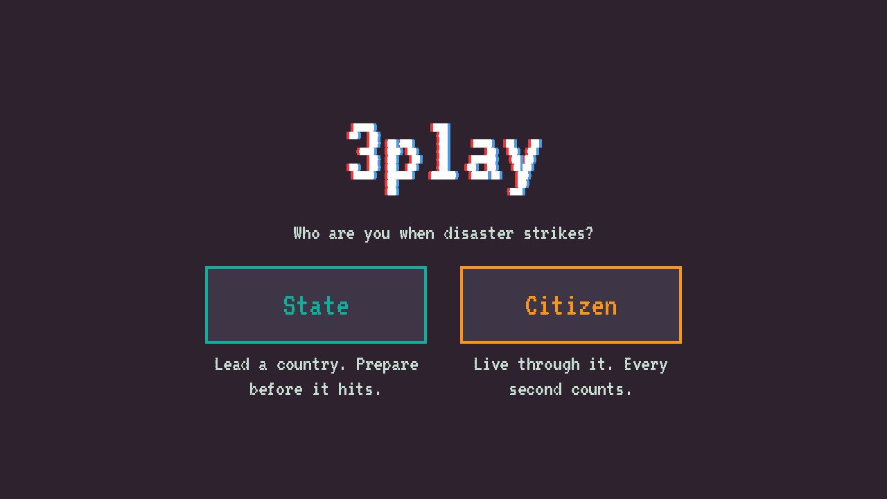
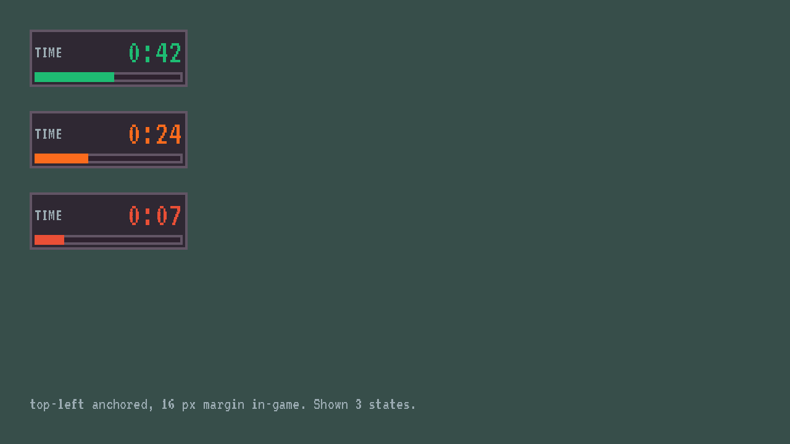
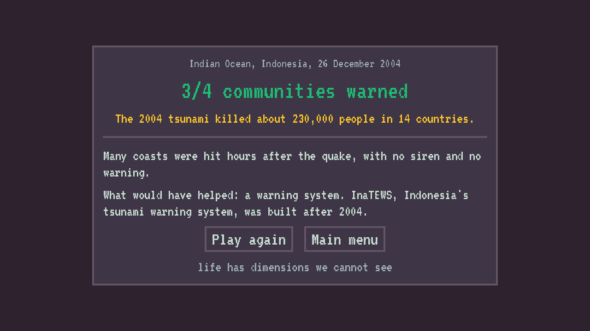

# UI design (#13)

Spec for role select, HUD timer, result card. Scenes are built in #14. Mockups below are rendered by Godot with the real theme and font.

## Use it

- Theme: `res://ui/theme.tres`, set as project default (`gui/theme/custom`). Every Control gets it, no per-scene setup.
- Regenerate after palette/style edits: `godot --headless --path . -s tools/build_theme.gd`. Never hand-edit `theme.tres`.
- Re-render mockups: `godot --path . -s tools/render_mockups.gd` (needs a window).
- Colors in code: `Palette.SAFE`, `Palette.DANGER`, etc. (`ui/palette.gd`). Only Resurrect 64 colors.
- Text: put the `locale/strings.csv` key in `text` (Label/Button auto-translate) or `tr("KEY")` in code. Never raw English.

## Grid and type

- 1 logical px = 4 screen px. Borders 4 px, margins/gaps in multiples of 4 (prefer 8, 16, 24, 32, 48).
- Font: VT323 (OFL), imported with antialiasing, hinting and subpixel off. One weight only: hierarchy comes from size and color, never fake bold. VT323 runs small, so sizes are about 1.3x a normal pixel font.
- No rounded corners, no gradients, no soft shadows.

| Type variation | Base | Size | Color |
|---|---|---|---|
| (default) | Label | 32 | TEXT |
| `TitleLabel` | Label | 80 | WHITE |
| `HeaderLabel` | Label | 48 | TEXT |
| `MutedLabel` | Label | 28 | MUTED |
| `NumberLabel` | Label | 56 | GOLD |
| `SafeLabel` | Label | 56 | SAFE |
| `TimerLabel` | Label | 56 | SAFE (code sets WARN/DANGER) |
| `ClosingLabel` | Label | 32 | MUTED |
| (default) | Button | 40 | panel + BORDER, hover TEXT border, focus GOLD |
| `StateButton` / `CitizenButton` | Button | 48 | role accent border and text |
| `HudPanel` | PanelContainer | | BG 85% + BORDER |
| `TimerBar` | ProgressBar | | fill SAFE (code swaps to WARN/DANGER) |

## Palette roles (Resurrect 64)

| Role | Hex | Use |
|---|---|---|
| BG | `#2e222f` | screen background |
| PANEL | `#3e3546` | cards, buttons |
| PANEL_DARK | `#45293f` | pressed |
| BORDER | `#625565` | outlines, separators |
| MUTED | `#9babb2` | secondary text |
| TEXT | `#c7dcd0` | body text |
| WHITE | `#ffffff` | titles, hover text |
| SAFE | `#1ebc73` | people saved, timer > 30 s |
| WARN | `#fb6b1d` | timer 10-30 s |
| DANGER | `#ea4f36` | timer < 10 s, fail |
| GOLD | `#f9c22b` | real-event numbers, focus |
| STATE | `#0eaf9b` | State role |
| CITIZEN | `#f79617` | Citizen role |
| GLITCH_A / B | `#e83b3b` / `#4d9be6` | logo split, 4D glitch |

## Logo

`ui/logo.tscn`: 3 stacked labels showing `GAME_TITLE`, red copy 4 px left, blue copy 4 px right, white on top. This is a chromatic "glitch" split that matches the globe glitch. Game name is undecided. It is a placeholder (`3play`) until then, and changing it only needs the CSV value.

## Role select (`scenes/main.tscn`)

- Center column, 32 px gap: logo, `MENU_PROMPT`, two role cards.
- Role card: button 320x112 (`StateButton` / `CitizenButton`) + description as default Label (TEXT, 32), wrap at 320. Not MutedLabel: too faint at this size.
- Keyboard: buttons focusable, focus border GOLD.

## HUD timer (`scenes/ui/hud_timer.tscn`)

- `HudPanel`, anchored top-left, 16 px margin. `HUD_TIME` (MutedLabel) + `m:ss` (TimerLabel) on one row, `TimerBar` 240x16 below.
- > 30 s: SAFE number and bar. 10-30 s: WARN. < 10 s: DANGER (optional: blink every 0.5 s).

## Result card (`scenes/result.tscn`)

- `PanelContainer` 880 wide, centered. `<D>` = disaster prefix (`IO`, `KAHR`). Order:
  1. `<D>_PLACE`, `<D>_YEAR` (MutedLabel)
  2. `<D>_CARD_SCORE` with `%d` = player score (SafeLabel; DANGER if under half)
  3. `<D>_CARD_NUMBERS`, the real event (default Label, GOLD)
  4. separator
  5. `<D>_CARD_FACT`, then `<D>_CARD_HELP` (default Label, wrap 800). Extra lines like `KAHR_CARD_COLD` go here too.
  6. buttons `RESULT_REPLAY`, `RESULT_MENU`
  7. `CLOSING_LINE` (ClosingLabel)
- No section headers: the HELP text already starts with "What would have helped:".

## Strings

All keys live in `locale/strings.csv` (`key,en,tr`). UI keys: `GAME_TITLE`, `MENU_PROMPT`, `ROLE_*`, `HUD_TIME`, `RESULT_REPLAY`, `RESULT_MENU`. Their `tr` cells are empty for now (game ships in English; Turkish later).
